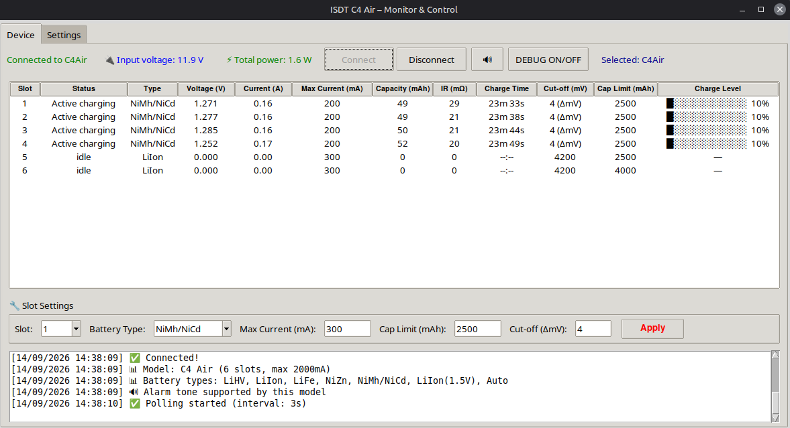
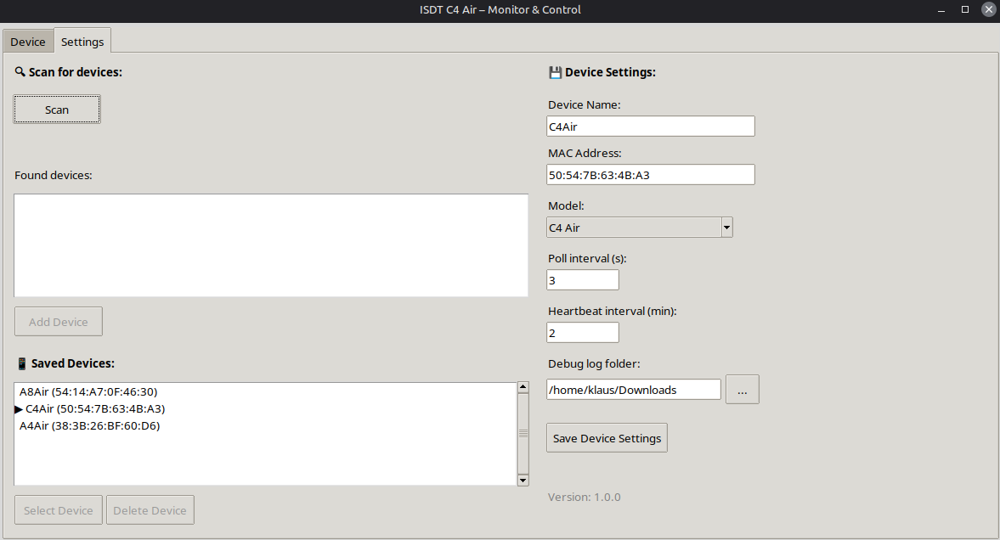

# ISDT Charge Utility

**Cross-platform GUI for ISDT C4 Air, A4 Air, A8 Air battery chargers on Windows and Linux**

Monitor and control your ISDT charger via Bluetooth Low Energy (BLE), including charging status, battery type, charge current, capacity limit and cut-off voltage

- Direct Bluetooth Low Energy (BLE) connection.

- Works under Windows and Linux.

  
---

## ⚠️ DISCLAIMER / HAFTUNGSAUSSCHLUSS

**IMPORTANT - PLEASE READ CAREFULLY**

This software is provided "AS IS" and "WITH ALL FAULTS" without warranty of any kind, express or implied.

**By using this software, you agree that:**

1. **USE AT YOUR OWN RISK** – The author assumes NO responsibility or liability for any damages, injuries, or losses resulting from the use of this software.

2. **BATTERY SAFETY** – Charging batteries incorrectly can cause fire, explosion, or personal injury. Always follow the battery manufacturer's safety guidelines.

3. **NO GUARANTEE** – The software may contain bugs or errors. It is your responsibility to verify all settings before starting a charge.

4. **HARDWARE DAMAGE** – The author is not liable for any damage to your charger, batteries, or other equipment.

5. **NO WARRANTY** – This software comes with no warranty, express or implied. The entire risk of using the software is with you.

**Du verwendest diese Software auf eigene Gefahr!**  
Der Autor übernimmt keinerlei Haftung für Schäden an Geräten, Batterien oder Personen.

---
## 📸 Screenshots

| Main View | Settings |
| - | - |
|  |  |
---
## ✨ Features

### 📊 Monitoring

- **BLE Connection** – Direct communication with ISDT C4/A4/A8 Air

- **Auto-Connect** – Saved MAC address is used on startup

- **Dynamic GUI** – Adapts slot count and battery types based on detected model

- **Detailed Status** – Pre‑charge, CC, CV, done, error

- **Charge Time** – Read directly from the device

- **Battery Bar** – Visual representation of charge level

- **Input Voltage & Total Power** – Total Power = Power consumption of the device

- **Hardware Info** – Firmware and hardware version displayed on connect

- **Automatic Polling** – Regular data updates (interval adjustable)

- **Timeout Detection** – Detects when the device is powered off
---
### ⚡ Control

- **Set Battery Type** - LiHV, LiIon, LiFe, NiZn, NiMh/NiCd, LiIon(1.5V), Auto 

- **Set Charge Current** – 100–4000 mA (model-dependent maximum)

- **Set Capacity Limit** – Battery‑specific ranges (0 = unlimited)

- **Set Cut‑off Voltage** – Battery‑specific ranges (0 = default)

- **Alarm Tone** – Toggle on/off with a single click (🔊/🔇)

- **Battery‑specific Validation** – Prevents invalid values

- **Model‑specific Validation** – Prevents unsupported battery types

- **Multiple Charger Profiles** MAC, device, interval, Bind UUID are saved for different Charges
---
## 🖥️ Supported Devices

| Model | Slots | Max Current | Status |
| - | - | - | - |
| ISDT C4 Air | 6 | 2000mA | ✅ Fully supported |
| ISDT A4 Air | 4 | 1000mA | ✅ Fully supported |
| ISDT A8 Air | 8 | 1000mA | ✅ Fully supported |
---
## 📋 Requirements

### Windows (EXE - for end users)

- **Windows 10 or 11** (with Bluetooth 4.0+)

- **No Python installation required!**

### Windows (Python - for developers)

- **Windows 10 or 11** (with Bluetooth 4.0+)
- **Python 3.13 or higher**
- **Bleak 3.1.0 or higher**

### Linux

- **Linux** with Bluetooth 4.0+
- **AppImage:** No Python installation required
- **Source installation:** Python 3.13 or higher
- **Native installation:** Bleak and Tkinter are installed through the distribution's package manager
- **Virtual environment:** Bleak 0.20.0 or higher

---
## 🔧 Installation & Usage

> **⚠️ Important:** The ISDT charger must **NOT** be paired via Bluetooth settings! Do **NOT** use "Add Bluetooth device" inside Windows/Linux to pair the charger. The app handles the BLE connection directly.

### 🪟 Windows (EXE – Recommended for end users)

> **No Python installation required!** Just download and run.

1. Download the latest `ISDT-Charge-Utility.exe` from the [GitHub Releases](https://github.com/DittelHome/ISDT-Charge-Utility/releases/latest).

2. Double-click `ISDT-Charge-Utility.exe` to start the application

**Done!** 🎉

### 🪟 Windows (Python – for developers)

1. Clone or download the repository

```cmd
git clone https://github.com/DittelHome/ISDT-Charge-Utility.git
cd ISDT-Charge-Utility
```

2. Create a virtual environment

```cmd
py -3.13 -m venv .venv
```

3. Activate the virtual environment

```cmd
.venv\\Scripts\\activate
```

4. Install dependencies

```cmd
python -m pip install --upgrade pip
python -m pip install "bleak>=3.1.0"
```

5. Run the application

```cmd
python isdt.py
```

### 🐧 Linux – AppImage (recommended for end users)

The AppImage contains the application and its Python dependencies. No separate Python or pip installation is required.

1. Download the latest `ISDT-Charge-Utility-x86_64.AppImage` from the [GitHub Releases](https://github.com/DittelHome/ISDT-Charge-Utility/releases/latest).

2. Make the AppImage executable

```bash
chmod +x ISDT-Charge-Utility-x86_64.AppImage
```

3. Run the application

```bash
./ISDT-Charge-Utility-x86_64.AppImage
```

**Note:** Bluetooth access still depends on the Linux system's BlueZ/D-Bus configuration.

### 🐧 Linux – Native installation

This variant uses the Python packages provided by your Linux distribution. No virtual environment or pip installation is required.

1. Install system packages

```bash
sudo apt update
sudo apt install python3 python3-bleak python3-tk
```

2. Clone or download the repository

```bash
git clone https://github.com/DittelHome/ISDT-Charge-Utility.git
cd ISDT-Charge-Utility
```

3. Run the application

```bash
python3 isdt.py
```

### 🐧 Linux – Virtual environment (for developers)

Use this variant if you prefer an isolated Python environment or if your distribution does not provide a suitable Bleak package.

1. Install prerequisites

```bash
sudo apt update
sudo apt install python3 python3-venv python3-tk
```

2. Clone or download the repository

```bash
git clone https://github.com/DittelHome/ISDT-Charge-Utility.git
cd ISDT-Charge-Utility
```

3. Create a virtual environment

```bash
python3 -m venv .venv
```

4. Activate the virtual environment

```bash
source .venv/bin/activate
```

5. Install dependencies

```bash
python -m pip install --upgrade pip
python -m pip install "bleak>=0.20.0"
```

6. Run the application

```bash
python isdt.py
```

## 🚀 Usage

### Start App (Windows EXE / Python / Linux AppImage)

1. **Start the app** – Double-click `ISDT-Charge-Utility.exe`, run the Linux AppImage, or start the Python version with `python isdt.py`

2. **Scan and save your device** – Settings tab → Scan → Select → Save

3. **Connect** – Device tab → Connect (saved)
---
### Controlling Charging Parameters

1. **Select a slot** – Click on a table row or use the **"Slot"** dropdown

2. **Adjust values** – Battery type, Current, Capacity limit, Cut‑off

3. **Apply** – Click the red **"Apply"** button

4. **Alarm Tone** – Click the speaker icon (🔊/🔇) to toggle
---
### Battery‑specific Validation


| Battery Type | Capacity Limit (mAh) | Cut‑off (mV) |
| - | - | - |
| LiHV | 0 or 2000–7000 | 4250–4450 |
| LiIon | 0 or 2000–7000 | 4100–4300 |
| LiFe | 0 or 2000–7000 | 3550–3750 |
| NiZn | 0 or 2000–7000 | 1800–2000 |
| NiMh/NiCd | 0 or 1000–4000 | 3–12 (Delta‑Peak) |
| LiIon(1.5V) | 0 or 1000–4000 | none (0) |
| Auto | 0 or 2000–7000 | none (0) |
---
## 📊 Displayed Data

| Column | Description |
| - | - |
| **Slot** | Channel number (1-8 depending on model) |
| **Status** | Charge state (idle, pre-charge, CC, CV, done, error) |
| **Type** | Battery chemistry (NiMh/NiCd, LiIon, LiFe, etc.) |
| **Voltage** | Current battery voltage in volts |
| **Current** | Charge current in amperes |
| **Capacity** | Charged capacity in mAh |
| **IR** | Internal resistance in mΩ (only A4/C4)|
| **Charge Time** | Elapsed charging time (from device) |
| **Charge Level** | Battery bar with percentage |

---

## 📊 Setting Data

| Column | Description |
| - | - |
| **Slot** | Channel number (1-8 depending on model) |
| **Battery type** | Battery chemistry (NiMh/NiCd, LiIon, LiFe, etc.) |
| **Current** | Maximum load capacity (protection mechanism) |
| **Capacity Limit** | Capacity Limit (protection mechanism) |
| **Cut off** | Only for NiMh/NiCd **delta values**, for the rest absolute values |

---

## 📁 Project Structure

| File | Description |
| - | - |
| `isdt.py` | Main program (tkinter GUI) |
| `isdt_ble.py` | BLE communication (connection, polling, control) |
| `isdt_protocol.py` | Protocol definitions and parsers |
| `isdt_config.py` | Settings load/save |
| `isdt_models.py` | Model definitions (C4/A4/A8) |
| `icon.png` / `icon.ico` | Application icon |
| `PROTOCOL.md` | Technical BLE protocol documentation |


## ⚙️ Configuration

Settings are stored in:

- **Linux:** `~/.isdt_gui_config.json`

- **Windows:** `C:\Users\username\.isdt_gui_config.json`

## 🐛 Troubleshooting

### Device with address ... was not found

- **DO NOT pair** the device via Windows/Linux Bluetooth settings

- Close the ISD Link app on your smartphone

### Connection Timeout

- Make sure the charger is near enough of your PC

- **Close the ISD Link app** on your smartphone or on a second PC (IMPORTANT!)

- If Bluetooth communication fails (connection drops, no data received), update your Bluetooth driver (especially Intel adapters) – this often resolves connectivity issues.

### Device is rebooting sometimes

- Make sure you have a good USB‑C power adapter. (No multiport USB Chargers)

- Some ISDT Charger requires 12 V, otherwise it won't charge Li‑ion batteries (C4Air).

## 📝 Developer Notes

### Protocol

The BLE protocol is based on the documentation from the [Home Assistant Integration](https://github.com/mtheli/isdt_air_ble) for reading, and reverse‑engineered from the ISD Link Android app for writing. See [Protocol description](https://github.com/DittelHome/ISDT-Charge-Utility/blob/main/PROTOCOL.md)

## Known Issues

- **None currently known**

## 💻 Platform Support

| Platform | Support | Notes |
| - | - | - |
| **Windows (EXE)** | ✅ Full support | **No Python required!** |
| **Windows (Python)** | ✅ Full support | Python 3.13+ |
| **Linux** | ✅ Full support | Tested on Ubuntu/Debian |
| **macOS** | ❌ Not tested | - |


The program works natively on both Linux and Windows.

## 📜 License

MIT License – see [LICENSE](LICENSE) file.


## 🙏 Acknowledgments

- [mtheli/isdt\_air\_ble](https://github.com/mtheli/isdt_air_ble) – Home Assistant integration as protocol reference (read commands)

- [bleak](https://github.com/hbldh/bleak) – BLE library for Python

**Note:** This is an independent community project and is not affiliated with, endorsed by, or sponsored by ISDT.

